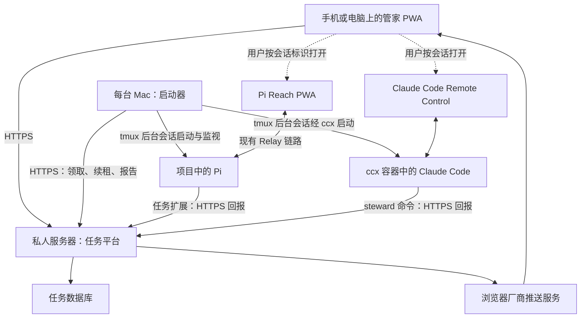

# 首版方案：任务台账与 Mac 启动器自动领取

记录日期：2026-11-12；2026-11-19 调整架构，并补充两种 Agent 接入与启动方式。

本文是本项目当前方案入口。系统尚未实现；「已确认」表示产品与架构方向已确定，「暂定」表示已选定但需真机验证后确认，「建议」表示可供实现采用但尚需核验的技术选择，「待设计／待验证」不构成已经存在的能力。

2026-11-19 调整：原方案由控制台派发任务、worker 通过 RPC 托管 Pi 进程，平台还负责会话收尾、恢复和跳转，复杂度集中在平台接管「Pi 怎么运行」。现改为：平台只做任务台账并判断哪些任务可以领取，每台 Mac 的启动器自动领取任务并启动 Agent，项目 Agent 自己完成工作并回报。执行任务的 Agent 支持 Pi 与 Claude Code 两种，首版先接 Pi；Agent 还可以在用户要求时代为查看和整理任务。原决策的去留见第 10 节。

本文中的 Agent 指执行任务的 Pi 或 Claude Code；只适用于其中一种的内容会单独注明。产品背景、术语和主要使用路径以 [CONTEXT](../../CONTEXT.md) 为准；[README](../../../README.md) 提供文档导航。

## 1. 核心思路与职责边界

平台安排任务、保存结果并提醒用户；启动器让 Agent 在无人值守时也能开工；任务怎么完成，交给项目 Agent 和项目已有规范。

| 部分 | 负责 | 不负责 |
| --- | --- | --- |
| 任务平台 | 任务清单与状态、领取条件、领取与租约、交付与验收记录、「需要我处理」视图、Web Push | 不接模型；不托管 Agent 进程；不判断工作是否正确；不解析对话 |
| Mac 启动器 | 登记本机项目；按本机空闲名额领取任务；在后台 tmux 会话中启动 Agent 并带上任务背景；报告 Agent 进程运行与退出 | 不管理会话收尾时序；不判断交付质量 |
| 项目 Agent | 讨论、调查、实现、验证与返修；按项目规范处理分支、提交与验证；回报进展、问题、决定与交付；交付后结束进程；用户要求时代为查看、创建和修改任务。Pi 经任务扩展接入，Claude Code 以技能为主接入 | 不负责跨任务调度、其他电脑的名额与全局验收积压；不能安排任务开始或验收 |
| 对话入口 | Pi 会话使用 Pi Reach；Claude Code 会话使用其 Remote Control（待验证）；也可在 Mac 终端接入 tmux 会话 | 不保存任务，不启动 Agent |

Agent 与项目已有的能力直接复用，平台不重复建设：

| 事项 | 处理方 |
| --- | --- |
| 模型限流、临时错误重试、上下文压缩 | Agent 原生能力，沿用其配置 |
| 调查问题、修改代码、测试失败后继续修复 | 项目 Agent，按任务授权与项目规范 |
| 执行哪些验证、如何提交、怎样整理交付 | 项目 Agent，按项目规范 |
| 创建分支与 worktree | 项目 Agent，按项目规范 |
| 截图、项目已有预览、验收步骤 | 项目 Agent，视任务提供 |
| 对话保存与加载 | Agent 原生会话 |
| Agent 进程退出、Mac 离线、与平台断线 | 启动器与平台 |

Agent 进程运行时，项目中的问题由它自己处理；进程已经退出，才由启动器报告、平台记录并通知用户。

## 2. 已确认决策

| 编号 | 决策 | 具体含义 |
| --- | --- | --- |
| D01 | 自建统一任务清单 | 直接在本系统创建、整理和安排任务，不以外部待办工具为前提；任务不区分讨论与执行类型；记录待办与安排开始是两个动作 |
| D02 | 平台在私人服务器单容器部署 | 使用已有 Docker Compose 与 HTTPS 环境；服务器系统和部署参数待核实 |
| D03 | 平台不接模型 | 所有模型工作发生在执行 Mac 的项目 Agent 中，平台不需要模型凭据 |
| D04 | 执行端首版仅支持 macOS | 每台执行 Mac 运行一个启动器；该限制不指定服务器操作系统 |
| D05 | 启动器自动领取任务 | 启动器按本机空闲名额主动领取本机项目中可领取的任务；领取原子完成并带租约，同一任务不会被两处同时领取 |
| D06 | 名额等于运行中的 Agent 进程 | 每台 Mac 可配置，默认 1；Agent 等待用户回应期间进程仍在运行，继续占用名额；进程退出即释放 |
| D07 | 每次领取新开会话 | 不同任务使用新的 Agent 会话。同一任务返修时优先回到原会话，保留原生历史。恢复方式见第 5.4 节 |
| D08 | 按项目所在电脑领取 | 单机项目只由该电脑领取；多机项目可指定电脑，未指定时限定为该项目上次使用的电脑，首次无历史时需指定；指定电脑离线时等待，不自动换机 |
| D09 | 领取条件由平台判断 | 依赖满足、待验收未达上限、电脑匹配；返修优先于普通任务且不受积压上限限制；待验收上限初始为三项，可配置 |
| D10 | 进程退出未交付即中断 | 任务进入已中断并保留进展；由用户决定重新安排或取消，启动器不自动重开 |
| D11 | Agent 明确回报，启动器只报进程事实 | Agent 回报进展、问题、决定与交付；启动器报告会话标识、进程运行与退出；平台不从对话或日志推断结果 |
| D12 | 交付后结束进程 | Agent 提交交付并收尾后结束进程，任务进入待验收；需要继续讨论或修改时由用户发起返修，重新进入领取 |
| D13 | Git 由项目 Agent 按项目规范处理 | 代码交付绑定本地提交；源码留在执行 Mac，平台只保存提交引用；默认使用独立分支与 worktree，由项目 Agent 创建，见第 7 节 |
| D14 | 两种依赖条件 | 验收后继续（默认）与交付后继续；后项领取时记录所用的前项交付版本，前项之后返修只提示，不改动后项 |
| D15 | 对话通过各 Agent 的远程入口 | 任务记录执行电脑、Agent 类型与会话标识；Pi 会话在 Pi Reach 打开，Claude Code 会话经其 Remote Control 打开（待验证）；精确会话深链作为后续增强 |
| D16 | 首期使用 PWA Web Push | 在需要回应、待验收和已中断时，从服务器发送系统通知 |
| D17 | 遵循项目与任务权限 | 不增加通用工具审批平台；项目规则与任务配置共同决定允许的动作 |
| D18 | 身份按个人私用简化 | 暂不公开提供服务；保留平台访问认证；每台电脑一个长期机器令牌，可单独撤销 |
| D19 | 首版只由启动器领取 | 用户在终端手工打开的 Agent 不领取任务、不计入名额，可继续独立使用，也可在用户要求时管理任务（D25）；手工会话领取延后 |
| D20 | 验收后的处理遵循项目流程 | 推送、合并、发布仍在各自项目中处理，不设置统一集成阶段 |
| D21 | 启动器与 Agent 均以机器令牌直连平台 | 机器令牌保存在本机配置中，启动器与 Agent 共用；启动器以它通过 HTTPS 轮询领取、续租并报告进程运行与退出；Agent 以它加当前执行编号直接以 HTTPS 回报，执行编号由启动器经环境变量传入，不写入提示词；平台只接受属于该电脑且尚未结束的执行编号；任务管理只需要机器令牌，见 D25；Mac 无需开放公网端口 |
| D22 | 支持 Pi 与 Claude Code 两套接入，首版先接 Pi | Pi 经任务扩展接入；Claude Code 以通用技能为主接入，经 ccx 启动，任务背景注入系统提示词；两者共用同一套平台与启动器协议，见第 6 节 |
| D23 | Pi 已确认使用 tmux 交互模式 | 启动器在后台 tmux 会话中以交互模式启动 Pi，用户可在终端接入查看或接手。Claude Code 的启动方式待验证，见第 5.4 节 |
| D24 | 创建任务时指定 Agent | 每个任务在创建时指定由 Pi 还是 Claude Code 执行；启动器按任务指定的 Agent 启动 |
| D25 | Agent 可代用户管理任务 | 用户在任意会话（包括手工打开的会话）中要求时，Agent 可查看、创建和修改任务；不能安排开始，也不能验收或标记完成；复用配对时的机器令牌，不再另外配置凭据；撤销电脑令牌会同时停用执行和代管。写入记录来源电脑与会话，见第 6.4 节 |

## 3. 系统结构

Mac 只主动连接平台，无需开放公网端口。任务链路与对话链路互不依赖：Relay 不承担任务存储或调度，平台身份也不替代 Pi Reach 配对或 Claude 账号登录。

## 4. 任务与状态

### 4.1 主状态

| 状态 | 含义 | 进入方式 |
| --- | --- | --- |
| 未安排 | 只记录了待办，可继续补充整理 | 用户或 Agent 新建任务 |
| 待领取 | 已安排开始，等待满足领取条件；页面说明当前在等什么（依赖、验收积压、电脑离线或名额已满） | 用户安排开始、要求返修或重新安排已中断任务 |
| 进行中 | 启动器已领取并启动 Agent；等待用户回应期间仍处于此状态 | 领取成功 |
| 待验收 | Agent 已提交交付 | Agent 回报交付 |
| 已完成 | 用户确认当前交付版本 | 用户验收通过 |
| 已中断 | Agent 进程退出时没有交付 | 启动器报告进程退出且本次尝试无交付 |
| 已取消 | 用户放弃该任务 | 用户取消 |

以下信息附在任务上，不改变主状态：

- 需要回应：Agent 明确提出的问题和必要背景。用户在对应的对话入口回答；问题由 Agent 根据后续交流更新、解决或撤销，仅收到回复或打开会话不算已解决。
- 待核对：租约过期或电脑失联，暂无可靠证据。保留最后确认的状态，不凭断线认定失败或完成，见第 5.3 节。

待验收任务被要求返修后回到待领取并优先领取；已中断任务由用户重新安排或取消。完整转换表与字段待设计。

### 4.2 任务详情与集中视图

| 内容 | 行为 |
| --- | --- |
| 目标与约定 | 任务目标、验收要求和交流中已确认的重要决定；区分 Agent 的建议与用户已确认决定 |
| 当前进展 | Agent 在有意义的节点回报的已完成内容与当前工作，显示更新时间；平台不从日志自行总结 |
| 需要用户处理 | 待回应问题、待验收交付或中断；提供执行电脑、Agent 类型与会话标识，便于打开对应会话 |
| 已有交付 | 默认展示最新交付，可展开历史版本；旧版的确认不能应用到新版 |

「需要我处理」是同一份任务数据的集中视图，点入后仍是原任务。

### 4.3 运行、报告与验收分别记录

平台分别保存三种事实：Agent 进程是否在运行、项目 Agent 回报了什么、用户确认了什么。进程退出、退出码或测试通过都不直接证明目标满足；交付不等于验收通过。

## 5. 领取与执行

### 5.1 领取流程

1. 启动器定期向平台报告在线状态，本机有空闲名额时请求领取。
2. 平台从该电脑可领取的任务中选出一项：返修优先，其次按清单顺序。领取原子完成，生成一次执行尝试和租约。
3. 启动器按任务所用的 Agent，在任务所属项目的本机路径中启动新的会话（返修时优先恢复原会话），传入任务背景，并回报会话标识。
4. Agent 运行期间，启动器定期续租；进程退出后，启动器报告退出并释放名额，随后可以继续领取。
5. 本次尝试已有交付的任务进入待验收，没有交付的进入已中断。

任务背景包括目标与说明、已确认决定、所用依赖交付的提交引用、前次交付与返修反馈、工作区要求、本任务允许的动作。回报所需的执行编号与机器令牌不放在任务背景中，见第 5.4 节。

### 5.2 领取条件

- 任务处于待领取，且电脑符合 D08。
- 依赖满足：验收后继续要求前项当前交付已验收；交付后继续要求前项已有交付。
- 验收积压：待验收任务数未达上限时才领取普通任务；返修不受此限制。已在进行的任务照常完成，因此待验收可能暂时超过上限。
- 本机名额由启动器按运行中的 Agent 进程数判断。

自动续跑只依据用户已安排的任务和显式依赖，不由模型猜测下一项工作。

### 5.3 中断、离线与防重复

- 租约过期时标为待核对，不重新领取、不转给其他电脑，等启动器重新上线报告实际情况，或由用户处理。
- 启动器重启后按本机记录核对仍在运行的 tmux 会话与 Agent，继续续租或报告退出；不能只凭 PID 或超时断定进程不存在。
- 领取、续租和报告请求带稳定标识，重发不会重复领取；平台只接受尚未结束的执行编号的回报，迟到的旧尝试报告不能覆盖新尝试。
- 启动器先在本地保存待报告的进程事件，平台确认保存后再删除。
- Agent 的回报同步提交，失败时直接告知 Agent 稍后重试。Agent 在交付提交成功后才收尾退出，因此进程退出时交付已保存在平台，不会因先收到退出报告而误判为已中断。

### 5.4 启动方式：tmux 交互模式

Pi 的启动方式已通过真机验证，Claude Code 待验证。结果见第 9.2 节。

启动器为每次执行创建一个独立的后台 tmux 会话，会话名包含执行尝试标识，在其中以交互模式运行 Agent，首条消息即任务指令。这样 Agent 与手工打开时行为一致，对话入口照常可用；启动器重启不影响已启动的 Agent；用户可在 Mac 终端接入 tmux 会话查看或接手。tmux 会话退出即视为 Agent 进程退出。

结束由 Agent 内部发起：Agent 完成收尾后结束自身进程，tmux 会话随之退出，启动器据此报告退出。启动器关闭 tmux 会话只作为用户取消或异常清理时的兜底。

| 方面 | Pi | Claude Code |
| --- | --- | --- |
| 启动 | 在项目目录直接运行 `pi`，加载任务扩展与 Pi Reach 扩展。启动器应将 Pi 和 Node 的可执行目录加入 `PATH` | 运行 `ccx <项目目录> -- <Claude 参数>`；ccx 把 `--` 之后的参数原样传给 Claude |
| 任务背景 | 首条消息，任务扩展可再读取完整背景 | `--append-system-prompt` 注入系统提示词，首条消息要求开始任务 |
| 执行编号与机器令牌 | 执行编号经环境变量传入 Pi 进程；机器令牌从本机配置读取 | 执行编号经 ccx 的环境变量透传传入（需改造 ccx）；机器令牌从容器 home 中的配置读取；两者都不写入提示词 |
| 会话标识 | 启动时用 `--session-id` 指定，任务扩展可读取该标识和会话文件路径 | 启动器生成 UUID，以 `--session-id` 指定 |
| 无人值守权限 | 按项目与任务配置。本次测试项目无需 `-a` | 以 `--permission-mode` 按任务配置，否则会停在工具授权确认上 |
| 对话入口 | Pi Reach | `--remote-control` 开启 Remote Control |
| 返修恢复 | 在同一项目目录用原 `--session-id` 打开原会话，首条消息传入返修要求 | `--resume <会话标识>` |
| 退出 | 扩展请求 Pi 正常退出。真机测试中，正常退出和强制关闭 tmux 会话均触发 `session_shutdown`，且无残留 Pi 进程 | 由 Claude 内部发起，具体做法待验证 |

以上 Claude Code 参数已在容器内 Claude Code 2.1.311 的帮助中核对存在，ccx 的参数透传与会话环境变量已在 agent-tools 仓库源码中核对；实际效果仍需第 9.2 节验证。

Claude Code 经 ccx 运行的约束与改造建议。ccx 属于 agent-tools 项目，可以按需调整，改动在该项目另行实施：

- 同一项目的 ccx 会话共用一个容器，只有最后一个会话退出时才停止容器。用户同时在该项目开着其他 ccx 会话时，关闭 tmux 会话不一定结束容器中的 Claude，因此结束必须由 Claude 内部发起。建议 ccx 在客户端退出时结束它在容器中启动的进程，使关闭 tmux 会话也能可靠结束 Claude。
- ccx 当前不把宿主机环境变量带入容器，需要增加透传参数以传入执行编号；这是 Claude Code 接入的前置改动。
- 容器内的 `steward` 命令经容器的外网代理直接访问平台，不需要访问宿主机上的服务；需确认代理能访问平台地址。
- worktree 必须位于 ccx 挂载的目录内（例如项目目录下被 Git 忽略的子目录），否则容器内不可见；需要时可再让 ccx 支持挂载指定目录。

Pi 的 RPC 子进程模式保留为备选。Pi Reach 的端到端测试曾以 `pi --mode rpc --approve --continue` 启动 Pi，从 RPC 输出读取会话标识并收到 Pi Reach 的连接信息（Docker 中、测试用模型）。

启动器以用户级 LaunchAgent 托管，用户保持登录为运行条件。锁屏不影响运行；退出登录或休眠会影响启动器。首版不承诺无人登录时执行或自动唤醒电脑。

## 6. Agent 接入、任务管理与交付

### 6.1 共同的交互内容

两种 Agent 回报同样的内容，使用机器令牌加当前执行编号直接以 HTTPS 提交平台，平台核对执行编号属于该电脑且尚未结束（D21）：

| 入口 | 用途 |
| --- | --- |
| 读取任务 | 获取目标、决定、依赖成果、前次交付与反馈 |
| 更新进展 | 在有意义的节点说明已完成什么、正在做什么、有什么障碍 |
| 提出与更新问题 | 提出需要用户回应的事项，依据后续交流更新、解决或撤销 |
| 记录决定 | 保存重要约定，区分 Agent 建议与用户已确认内容 |
| 提交交付 | 提交本次结果、实际验证、验收方法及版本引用 |
| 结束 | 完成收尾后结束进程 |

Agent 能读取本机的机器令牌，可以代该电脑领取任务或报告其他执行；这是个人自用下接受的代价，令牌泄露时撤销该电脑的令牌并重新配置。具体命令或工具名称、字段与配置文件格式待设计。

### 6.2 Pi：任务扩展

任务扩展以 Pi 工具提供上述入口，可读取当前会话标识并回报，交付与收尾完成后可用 `ctx.shutdown()` 请求正常退出。扩展运行在宿主机的 Pi 进程中，从环境变量获得执行编号，从本机配置读取平台地址与机器令牌。

### 6.3 Claude Code：技能为主

Claude Code 通过一个通用技能接入：技能说明何时回报、回报什么，并附带 `steward` 命令（见第 6.4 节），放在技能目录中，无需在各项目容器中另行安装。启动器经 `--append-system-prompt` 把任务背景注入系统提示词，并要求按技能回报；执行编号与机器令牌按第 5.4 节获得。「结束」由 `steward` 命令在交付已保存后结束所在的 Claude 进程，具体做法待验证。需要时可再用 Claude Code 的 hooks 补充自动上报，属于可选增强。

技能只靠模型按说明调用，没有扩展那样的生命周期钩子。由此带来的风险有限：进程事实由启动器掌握，模型漏报交付时任务会进入已中断，不会被误判为完成。

### 6.4 任务管理

除执行回报外，Agent 可以在用户要求时代为管理任务，例如把讨论结果记成任务、查看某个任务的进展、补充任务说明。任何会话都可以使用，包括用户手工打开、不参与领取的会话。

| 方面 | 执行回报 | 任务管理 |
| --- | --- | --- |
| 使用者 | 启动器启动、正在执行任务的 Agent | 任何会话中的 Agent，在用户要求时使用 |
| 范围 | 只写本次执行尝试的进展、问题、决定与交付 | 查看、创建和修改任务；不能安排开始，不能验收或标记完成 |
| 凭据 | 本机的机器令牌加当前执行编号 | 本机已配对的机器令牌，不需要执行编号 |

两类操作都直接以 HTTPS 访问平台。Pi 复用随 `stew` 分发的扩展：普通会话可以查、建、改，有执行编号的会话才额外注册执行工具。不为代管另增命令行入口；Claude Code 的调用方式随接入另定。

Agent 新建的任务处于未安排；修改仅限标题、目标、验收要求和备注，版本不一致时拒绝覆盖。新建与修改记录来源电脑和会话。安排开始与验收只能由用户在网页操作。

### 6.5 交付内容

交付内容应帮助用户在数日后直接接手：

- 原目标、已确认范围与关键决定。
- 本次做了什么、没有覆盖什么。
- 实际执行的验证、结果及必要证据；未验证内容明确标注。
- 如何验收、入口在哪里、预期行为是什么。验收材料由 Agent 视任务提供，例如报告、截图、项目已有的可访问预览，或需在 Mac 上操作的步骤；首版不建统一预览平台。
- 对应提交或报告版本、已知问题。

## 7. Git 与交付引用

- Git 项目的任务默认使用独立分支与 worktree，不纳入用户原目录的未提交改动；返修复用原工作现场。worktree 由项目 Agent 按项目规范创建，项目中的 Pi 已具备该能力，启动器只在任务背景中提出要求；Claude Code 需遵守第 5.4 节的挂载约束。
- 代码任务进入待验收前形成本地提交；平台记录执行电脑、项目、基线提交、交付提交及验证摘要，不保存源码。讨论或调查等无代码改动的任务不制造空提交，使用报告版本。
- 依赖：后项领取时，平台把前项交付的提交引用写入任务背景并记录；如何基于它建立工作区由 Agent 处理。前项之后返修，平台在后项上提示前置交付已有更新，不改动后项。跨电脑的提交不自动搬运，需在项目既有流程下使其可用。
- 任务结束不自动删除分支、worktree 或交付引用；保留与清理方式待设计。
- 推送、合并与发布按各项目流程处理，平台分别记录实际结果。

## 8. 通知与管家 PWA

通知采用管家 PWA 的标准 Web Push，由服务器主动发送，不依赖页面常驻前台。触发时机为需要回应、待验收和已中断；普通过程留在任务详情。任务变化与通知发件箱在同一事务中保存，通知失败可重试，不回滚已保存的交付；通知丢失不影响任务记录。

需要实现通知授权入口、订阅登记与撤销、服务端推送密钥、发送重试与失效订阅清理、点击打开对应任务。订阅和密钥按凭据对待，不写入公开链接或日志。

已核对的浏览器条件：PWA 使用 HTTPS，用户明确操作后请求授权；iPhone／iPad 从 iOS／iPadOS 16.4 起支持添加到主屏幕的 Web App 推送；系统通知受网络、系统设置与专注模式影响，送达不代表已读。参考：[WebKit：主屏幕 Web App 的 Web Push](https://webkit.org/blog/13878/web-push-for-web-apps-on-ios-and-ipados/)、[MDN：Push API](https://developer.mozilla.org/en-US/docs/Web/API/Push_API)。平台支持不等于本项目已通过真机验收。

管家 PWA 优先复用 Pi Reach 的 React／Vite／Mantine、主题、安装与更新等基础；应用身份、Manifest、缓存与存储独立，不内嵌聊天，不迁移 Pi Reach 的 Dexie 会话库。

复用方式已确认为先复制、后提取：首版只把需要的基础复制到本项目，包括视觉 token、Mantine 主题、中英文案的组织方式与视口、安全区等小工具；记录来源的 Pi Reach 提交，保留其 MIT 许可声明，不改动 Pi Reach，不复制聊天与会话相关代码。首版前端稳定后，再对照两边重复的部分，评估是否提取为共享包以及放在哪里、如何发布。首版界面与交互以[任务平台原型](../../prototypes/20261119-task-console/index.html)为评审依据。

## 9. 技术基线、验证与实施顺序

### 9.1 建议技术基线

| 部分 | 建议 | 待确认 |
| --- | --- | --- |
| 任务平台 | Node.js + TypeScript，单容器提供 PWA 静态资源、API 与推送 | 框架、运行时版本与部署参数 |
| 数据 | 服务器本地 SQLite 加持久卷，平台单点写入 | 最终选型、迁移、备份与恢复 |
| 启动器 | Node.js + TypeScript，用户级 LaunchAgent 托管，经 tmux 启动 Agent | LaunchAgent 安装后实测、可执行文件发现、登录、睡眠与重启行为 |
| Pi 接入 | 薄 Pi 任务扩展 | 工具字段和平台联调 |
| Claude Code 接入 | 通用技能调用技能目录内的 `steward` 命令，系统提示词注入任务背景 | 提示词模板、脚本形式、权限模式 |
| `steward` 命令行 | 执行回报与任务管理共用，按凭据区分权限 | 命令范围、配置文件与令牌保存位置 |
| 通信 | 已确认采用 HTTPS 轮询（D21），可另加长连接作为唤醒提示 | 轮询间隔、租约时长 |

数据归属：服务器保存项目与电脑映射、任务、依赖、执行尝试、Agent 类型、会话标识、交付报告、验收记录与通知订阅；执行 Mac 保存源码、Git 工作区、Agent 原生会话、完整日志、模型认证与启动器待报告的进程事件；浏览器保存登录状态、通知授权与界面偏好。Mac 离线时仍可阅读服务器上已有的任务与交付。

### 9.2 实现前的真机验证

以下验证须在真实 Mac 上进行，结果写回本文：

| 编号 | 验证内容 | 通过证据 |
| --- | --- | --- |
| V1 | tmux 启动 Pi | LaunchAgent 环境下经 tmux 启动的 Pi 加载项目配置与扩展，按首条指令开始工作；Pi Reach 能看到该会话并在其中对话；能取得会话标识 |
| V2 | tmux 经 ccx 启动 Claude Code | 注入的系统提示词生效；指定的会话标识生效；按配置的权限模式无人值守不卡住；Remote Control 能打开该会话对话；容器内的 `steward` 能访问平台 |
| V3 | 结束与退出 | 两种 Agent 收尾后由内部结束进程，tmux 会话随之退出，启动器察觉；同项目另有 ccx 会话时容器内无残留 Claude 进程 |
| V4 | 返修恢复 | 两种 Agent 都能恢复指定会话，带入返修反馈继续工作 |
| V5 | 容器内 worktree | Claude Code 在 ccx 容器内创建的 worktree 位于挂载目录内，可正常工作且不影响原目录 |

#### 验证结果（2026-11-20，Pi 1.5.2，tmux 3.7c）

在 macOS 宿主机按 [Pi 真机验证步骤](../../../spikes/pi-launch/README.md) 执行。V1、V3、V4 使用独立的 `steward` tmux server。P-1 使用 `steward-minimal` 和 `env -i` 模拟启动器环境。原始探针日志保存在本机 `/tmp/steward-probe.log`。

| 检查项 | 结果 | 证据 |
| --- | --- | --- |
| 0 准备 | 通过 | Pi 1.5.2 的帮助保留 `--session-id`、`--append-system-prompt`、`-a`、`-e`、`-n`，探针扩展正常加载。Pi Reach 扩展完成连接。 |
| 1-1 无人值守开工 | 通过 | 首条指令自动执行，测试项目的 `hello.txt` 内容为 `hello`。 |
| 1-2 项目规则加载 | 通过 | 首轮回复末行是 `[项目规则已加载]`。 |
| 1-3 执行编号传入 | 通过 | `session_start` 记录 `attemptId=probe-001`、`mode=tui`。 |
| 1-4 会话标识生效 | 通过 | `sessionId=steward-probe-001`，`sessionFile` 位于 `~/.pi/agent/sessions/--private-tmp-steward-probe-project--/2026-11-20T00-03-08-863Z_steward-probe-001.jsonl`。 |
| 1-5 无确认提示 | 通过 | 测试项目直接开工，无需 `-a`。tmux 提示 `extended-keys` 已关闭，未阻塞启动或对话。 |
| 1-6 Pi Reach 可对话 | 通过（重开原会话） | 首轮 Pi 完成写文件时自行调用 `steward_probe_finish` 并退出。用相同会话标识重开，未发新的启动指令。用户在 Pi Reach 问文件内容，收到 `hello`，同一轮问答也出现在 tmux pane。 |
| 3-1 Pi 正常退出 | 通过 | 明确要求调用退出工具后，PID `72700` 先记录 `finish_requested`，再记录 `session_shutdown`。 |
| 3-2 tmux 会话随之结束 | 通过 | Pi 正常退出后，`has-session` 退出码为 `1`，独立 server 随最后一个会话退出。 |
| 3-3 无残留进程 | 通过 | PID `72700` 已不存在，按会话名检查也未发现相关进程。 |
| 3-4 强制清理 | 通过 | `kill-session` 关闭 `steward-probe-002` 后，PID `72960` 已不存在，日志记录了 `session_shutdown`。 |
| 4-1 回到原会话 | 通过 | 新进程记录 `attemptId=probe-001-r1`，`sessionId` 和 `sessionFile` 与 1-4 一致。 |
| 4-2 保留原上下文 | 通过 | Pi 直接修改了原来的 `hello.txt`，没有追问文件名，磁盘内容为 `hello again`。 |
| 4-3 Pi Reach 可继续 | 通过 | 用户在同一 Pi Reach 会话中看到返修前的 `hello` 问答和退出记录。返修后再次询问，Pi 回复 `hello again`，与 tmux 一致。 |
| P-1 最小环境可启动 | 补齐 PATH 后通过 | README 原始 PATH 下报 `env: node: No such file or directory`，退出码 `127`。只补入本机 Node 所在的 `~/.nvm/versions/node/v24.22.3/bin` 后，Pi 回复 `最小环境可用`。启动器应同时准备 Pi 和 Node 的可执行目录。 |

V1、V3、V4 按检查项通过，确认 Pi 使用 tmux 交互模式。首轮开工和 P-1 复测都观察到 Pi 在未收到结束指令时调用退出探针。正式任务扩展应在确认交付已保存并完成收尾后才允许退出。

### 9.3 实施顺序

1. **已完成**：第 9.2 节的 Pi 真机验证（V1、V3、V4），确认 Pi 启动方式。
2. 首个可用版本：平台（任务清单、领取接口、简单页面、访问认证）、一台 Mac 的启动器和 Pi 接入，走通「记录 → 安排 → 自动领取 → Pi 工作 → 交付 → 验收或返修」。实施方案见[首版实施方案](20261119-first-version-implementation.md)。
3. Agent 任务管理：复用电脑令牌，为普通 Pi 会话提供查、建、改工具。
4. Claude Code 接入：在 agent-tools 项目完成 ccx 改造，完成 V2、V5 及 Claude Code 部分的 V3、V4，提供通用技能。
5. Web Push 通知。
6. 依赖、验收积压上限与多台 Mac。
7. 后续增强：精确会话深链、手工会话领取、Claude Code hooks 自动上报、费用记录。

以上为建议顺序，尚未排期。

### 9.4 待设计清单

| 项目 | 尚缺内容 |
| --- | --- |
| 数据与状态 | 数据表、字段、完整状态转换表、任务版本与并发修改 |
| 领取协议 | 接口、租约时长、续租与待核对判定、请求标识 |
| ccx 改造 | 环境变量透传、客户端退出时结束会话进程，在 agent-tools 项目实施 |
| Agent 接入 | 回报字段、Pi 扩展工具、Claude Code 技能与系统提示词模板、本机配置文件格式 |
| 身份与接入 | 平台访问认证形式，机器令牌的初始化、保存与撤销 |
| 部署 | 单容器入口、反向代理、持久卷与备份恢复 |
| 启动器安装 | LaunchAgent、Pi／ccx／tmux 入口发现、更新与回滚 |
| 通知 | 推送密钥、订阅生命周期、合并与频率 |
| 清单体验 | 搜索、归档、删除与离线缓存 |
| 费用 | 是否记录用量，计费来源与未知用量处理 |

## 10. 原决策的处理

2026-11-13 版方案的决策按新架构处理如下。「现对应」指第 2 节编号。

| 原决策 | 处理 | 说明 | 现对应 |
| --- | --- | --- | --- |
| D01 自建任务清单 | 保留 | 不变 | D01 |
| D02 单容器部署 | 保留 | 不变 | D02 |
| D03 中心不接模型 | 保留 | 不变 | D03 |
| D04 worker 仅 macOS | 保留 | worker 改称启动器 | D04 |
| D05 按项目所在电脑执行 | 保留 | 规则不变，改为领取条件 | D08 |
| D06 不同任务新开会话 | 保留 | 返修恢复方式待验证 | D07 |
| D07 遵循项目与任务权限 | 保留 | 不变 | D17 |
| D08 代码交付使用 Git | 保留 | 不变 | D13 |
| D09 源码留在执行 Mac | 保留 | 不变 | D13 |
| D10 验收后流程遵循项目 | 保留 | 不变 | D20 |
| D11 会话上限与验收积压 | 简化 | 名额等于运行中的 Agent 进程数；积压上限改为领取条件 | D06、D09 |
| D12 PWA Web Push | 保留 | 不变 | D16 |
| D13 跳转准确 Pi Reach 会话 | 简化 | 首版记录会话标识，由用户在对应入口打开；深链延后 | D15 |
| D14 统一任务 | 保留 | 不变 | D01 |
| D15 在 Pi Reach 直接交流 | 保留 | 扩展到 Claude Code Remote Control；等待回应期间进程运行并占用名额 | D06、D15 |
| D16 worker 确认结束后释放名额 | 简化 | 进程退出即释放 | D06 |
| D17 任务页组织与未交付暂停 | 简化 | 任务页不变；已暂停并入已中断 | D10 |
| D18 只纳管 worker 启动的会话 | 保留 | 改为只由启动器领取 | D19 |
| D19 默认隔离工作区 | 简化 | 要求保留，由项目 Agent 创建 | D13 |
| D20 明确基线和依赖版本 | 简化 | 依赖条件改为领取条件；前项返修只提示 | D14 |
| D21 Pi 回传含义、worker 核对事实 | 简化 | 启动器只报告进程事实 | D11 |
| D22 交付与收尾分开、新消息使结束意图失效 | 移除 | Agent 交付后结束进程，后续讨论或修改走返修 | D12 |
| D23 身份简化 | 保留 | 不变 | D18 |

随之移除的设计：平台主动派发、平台发起的会话恢复与进入对话前的会话准备、停稳信号与名额释放时序、仅阅读恢复不续跑的控制。2026-11-13 讨论中提出、尚未写入的四项建议：异常退出由用户决定是否继续、积压上限与返修优先已并入第 5 节；前项返修改为只提示；手机验收由 Agent 视任务提供材料，见第 6.5 节。
