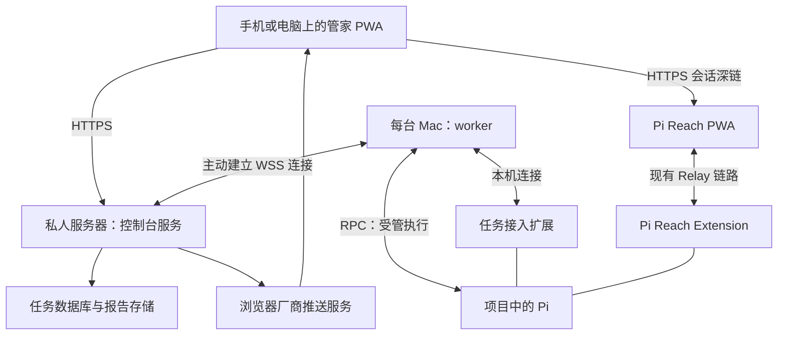

# 首版方案：线上任务控制台与 macOS 执行节点

记录日期：2026-11-12。

本文是本项目当前方案入口，依据已确认讨论整理。系统尚未实现；「已确认」表示产品与架构方向已确定，「建议基线」表示可供实现采用但尚需核验的技术选择，「待设计／待验证」不构成已经存在的能力。当前仅形成方案文档，业务实现、外部部署和 Pi Reach 集成仍待后续任务推进。

产品背景、术语和主要使用路径以 [CONTEXT](../../CONTEXT.md) 为准；[README](../../../README.md) 提供文档导航。

## 1. 已确认决策

| 编号 | 决策 | 具体含义 |
| --- | --- | --- |
| D01 | 自建任务清单 | 直接在本系统创建、整理、讨论和安排任务，不以外部待办工具为前提 |
| D02 | 中心部署到私人服务器 | 服务器持续保存任务、协调执行并发送通知；原固定 Mac 作为普通执行节点 |
| D03 | 控制台中心不接模型 | 无中心管家 Pi；讨论、判断和交付发生在具体项目的 Pi 中 |
| D04 | 首版 worker 仅支持 macOS | 每台执行 Mac 运行 worker；该限制不指定服务器操作系统 |
| D05 | 按项目所在电脑执行 | 单机项目直接定位，多机项目允许手动选择，未选择时使用该项目上次使用的电脑 |
| D06 | 不同任务默认新开 Pi 会话 | 原生会话记录保留，进程无需长期驻留；同任务可以恢复关联会话继续讨论或返修 |
| D07 | 遵循项目与任务权限 | 不增加通用工具审批平台；项目规则与任务配置共同决定允许的动作 |
| D08 | 代码交付使用 Git | 工作区内管理代码，代码任务进入待验收前形成本地提交，交付绑定指定提交 |
| D09 | 源码留在执行 Mac | 服务器保存任务、结论、报告与提交引用，不搬运项目源码 |
| D10 | 验收后的处理遵循项目流程 | 不设置强制统一集成阶段；推送、合并、发布仍在各自项目中处理 |
| D11 | 每机活跃会话上限可配置，限制验收积压 | 每台 Mac 单独配置最大活跃受管会话数，默认 1；待验收上限初始为三项并可调整 |
| D12 | 首期使用 PWA Web Push | 从服务器后台发送通知，补齐现有 PWA 尚无的订阅和推送处理 |
| D13 | 对话复用 Pi Reach | 从控制台任务进入对应 Pi Reach 会话，不在控制台重建聊天界面 |
| D14 | 统一任务，不刻意划分讨论与执行类型 | 同一任务可以在授权范围内讨论、调查、实现和验证；保存待办与安排开始仍是两个动作 |
| D15 | 需要回应时直接在 Pi Reach 交流 | 管家提醒并提供准确会话入口，不要求另填回答、提交继续或重新入队；等待回应不结束会话、不释放名额 |
| D16 | 明确结束会话后释放名额 | Pi 明确交付并完成收尾，或用户主动要求结束；worker 确认结束和释放后归还名额，历史保留，恢复也需取得名额 |
| D17 | 任务页围绕工作进展与交付组织 | 展示目标与约定、当前进展、需要用户处理的事项和已有交付；未交付时主动结束会话，任务暂停，需用户选择继续 |

以下技术结构是基于上述决策的建议基线。部署运行环境、接口和字段仍需实现前设计与验证，不把建议写成已完成实现。

## 2. 系统结构



两条网络链路职责不同：

- 管家链路：PWA 访问线上控制台，各 Mac 主动连接控制台，传递任务、控制命令与结果。
- 对话链路：浏览器打开 Pi Reach，按其现有配对和 Relay 链路访问具体 Pi。

建议管家链路直接使用 HTTPS／WSS，不再复用 Relay 的外层路由。Pi Reach 原有链路保持其职责，任务管家不将 Relay 变成任务库或调度服务。

所有模型认证与调用发生在执行 Mac。服务器可以保存模型显示信息和费用报告，但不需要模型凭据，也不调用模型生成计划、解释代码或判断任务完成。

## 3. 组件与存储

### 3.1 建议技术基线

| 部分 | 建议 | 验证边界 |
| --- | --- | --- |
| 控制台服务 | Node.js + TypeScript，首期单实例进程 | 框架、运行时版本、接口与部署方式未冻结 |
| 权威数据 | 服务器本地 SQLite，事务保存任务与通知事件 | 迁移、备份、恢复和大附件存储需要设计；不由各 Mac 共享打开数据库文件 |
| 管家 PWA | 复用已有 React／Vite／Service Worker 等基础能力 | 新应用独立身份、作用域与发布流程；不复制完整聊天业务 |
| Mac worker | Node.js + TypeScript，用户级 LaunchAgent 托管 | PATH、Pi 入口、登录、退出、睡眠和重启行为需要实测 |
| 受管 Pi | worker 启动独立 RPC 子进程 | 验证真实配置加载、事件、会话恢复、停止和子进程生命周期 |
| 本机扩展接入 | 薄 Pi 扩展与 worker 通信，倾向 Unix socket | 鉴权、权限、并发写入和重连协议待设计 |

LaunchAgent 方案以用户保持登录为运行条件。锁屏不等于退出登录；退出登录或 Mac 休眠会影响 worker。首版不承诺无人登录时执行或自动唤醒电脑。

### 3.2 数据归属

| 位置 | 保存内容 |
| --- | --- |
| 服务器 | 项目及机器映射、任务与版本、已确认决定、依赖、会话关联、执行状态、交付报告、验证摘要、验收反馈、必要附件、通知订阅与发件箱 |
| 执行 Mac | 源码、Git 对象与工作区、Pi 原生会话、完整执行日志、模型认证与本机配置、待回传事件 |
| 浏览器 | 登录或配对所需身份、通知授权与订阅关联、界面偏好；离线任务缓存策略尚待设计 |

服务器已有报告可以在执行 Mac 离线时阅读。源码检查、本机预览和会话恢复依赖对应 Mac 在线；不能将 Mac 本地文件路径直接当作手机可访问链接。

## 4. 任务模型与状态事实

### 4.1 统一任务与执行记录

任务不刻意区分讨论任务和执行任务。同一任务可以在授权范围内讨论、调查、实现、验证或返修；用户只需说明目标并安排开始，无需先选择工作类型。

任务和执行尝试分别记录，返修、重试或恢复保留历史。建议模型至少覆盖：项目、机器与目录映射、任务与任务版本、依赖、会话关联、执行尝试、交付、问题及其处理记录、验收、通知。

清单记录和执行队列分离。任务可以只有标题，加入队列时再检查必要背景、执行范围、依赖与交付要求；需要先讨论的工作不要求事先确定最终实现方案。

### 4.2 主进度与附加事实

已确认的正常主进度为：未安排 → 排队 → 进行中 → 待验收 → 已完成；未交付时主动结束会话，进入已暂停。具体存储枚举、完整转换表及异常处理仍待设计。

| 主进度 | 含义与触发依据 |
| --- | --- |
| 未安排 | 用户记录了待办，仍可补充与整理，尚未授权开始 |
| 排队 | 用户已安排开始，正在等待电脑、依赖或可用会话名额；页面说明具体等待原因 |
| 进行中 | worker 或已绑定的手工会话确认任务已开始；Pi 等待用户回应期间仍保留该进度 |
| 待验收 | 已有项目 Pi 明确提交的交付，等待用户或项目既有验收流程确认 |
| 已完成 | 指定交付版本已经得到确认 |
| 已暂停 | 用户主动结束会话且尚未交付；保留进展和工作现场，用户选择继续后才重新排队恢复 |

以下信息与主进度分别保存和呈现：

- 需要用户回应：展示 Pi 明确提出的问题和必要背景，通知用户进入准确的 Pi Reach 会话。回答、追问和调整要求都在原会话进行，不另设管家回答表单或重新入队步骤。提醒依据后续交流及问题处理情况更新，仅打开页面不算已解决；具体回传机制待设计。
- 运行事实：区分 Pi 正在工作、已经停稳或等待输入。Pi 可能提出问题后继续其他工作，不能收到问题就一律标记停止；等待回应时会话名额继续占用，见第 6.5 节。
- 离线或待核对：保留最后确认的主进度，标明电脑离线或缺少可靠证据，不凭断线认定失败、结束或完成。

用户主动结束未交付会话按暂停处理，与明确取消任务分开。失败、取消及非正常退出的具体状态与转换待细化；已暂停任务不自动再次启动。

### 4.3 任务详情与集中处理视图

任务详情按以下四块组织，会话和执行记录作为信息依据：

| 内容 | 已确认行为 |
| --- | --- |
| 目标与约定 | 保存任务目标、验收要求和交流中已确认的重要决定；区分 Pi 的建议与用户已确认决定，保留对应对话依据 |
| 当前进展 | 项目 Pi 在有意义的节点明确回传已完成内容与当前工作，worker 补充运行事实；显示更新时间，控制台不从零散日志自行总结 |
| 需要用户处理 | 有事项时展示问题、待验收交付或执行障碍及影响；回应问题或解释、修改交付时进入 Pi Reach，验收时确认当前交付版本，其他障碍按实际原因提供操作 |
| 已有交付 | 默认展示最新交付，可展开历史版本；内容要求见第 8 节，旧版确认不能应用到新版 |

「需要我处理」是同一份任务数据的集中视图，点入后仍是原任务。进入 Pi Reach 不自动清除提醒或视为验收通过。

### 4.4 运行、报告与验收分别取证

控制台分别保存三种事实：运行是否结束、项目 Pi 汇报了什么、用户确认了什么。退出码、运行结束事件、字段齐全或测试通过均不直接证明目标满足。

worker 可以机械核对提交存在、报告属于当前尝试、验证记录是否匹配版本。若 Pi 已停稳但没有明确报告，显示结果未明确或待核对，不能自动标记交付就绪。

项目规范要求的验证由项目 Pi 执行并报告；控制台不推导项目检查清单，也不在服务器重跑项目测试。交付使用统一内容要求，按实际工作提供提交或报告版本；具体字段和校验协议仍待定义。

## 5. 项目与执行电脑选择

1. 每台 Mac 登记本机有哪些项目及实际路径；项目身份不能只按目录名判断。
2. 项目只在一台 Mac 上时使用该电脑。
3. 项目登记在多台 Mac 时，任务可显式选择；未选择则使用该项目上次使用的电脑。
4. 没有历史选择时首次指定；具体提示时机与上次选择的更新时机待设计。
5. 已选择电脑离线时显示等待，不自动换机；用户可以在确认前置成果可用后改选。

跨机器执行不自动搬运源码或 Git 对象。若任务依赖某个仅在另一台 Mac 存在的提交，需要在项目既有流程下使该提交可用，否则继续等待或由用户调整机器。

## 6. Pi 会话与讨论

### 6.1 任务中的 Pi

同一任务中的讨论、调查、实现、审查和返修都由项目所在 Mac 的 Pi 加载实际项目上下文并开展工作，无需另建一种讨论任务。需要用户参与时，用户直接进入该任务的 Pi Reach 会话交流，Pi 在同一任务中继续推进；不因提问就关闭进程或要求用户重新安排开始。

Pi 读取任务目标、决定、参考资料、前置交付与反馈；有效讨论结论和交付说明回传服务器，完整对话保留为 Pi 原生会话，并通过 Pi Reach 阅读。

不同任务默认新会话。单个任务可以关联多次执行与多个历史会话，但进入对话必须明确选择当前或指定会话，不能把项目目录当作会话身份。

建议薄扩展提供读取当前任务、保存讨论结论、报告问题、提交交付等入口。工具名称、字段以及修改任务的授权与冲突处理尚未冻结。扩展不承担全局调度，不需要自行连接模型。

### 6.2 手工与受管执行

| 方式 | 责任边界 |
| --- | --- |
| 用户在终端打开 Pi | 扩展绑定任务并向本机 worker 上报；不因登记就获得进程所有权，不自动改动原工作区 |
| worker 启动 Pi | worker 管理工作区与 RPC 子进程，记录运行事件、会话和交付，并负责停止及恢复核对 |

已有手工会话如何绑定任务、事件如何持久化、何时可以接管或恢复，需要专门设计与验证。仅靠扫描目录或登记会话不能保证状态回传。

### 6.3 从控制台进入 Pi Reach

目标体验是点击任务的「进入对话」，准备对应会话后直接跳转 Pi Reach：

| 当前情况 | 目标行为 |
| --- | --- |
| Pi 进程运行中 | 解析当前准确会话位置并跳转 |
| 受管进程已释放，Mac 在线 | 先取得本机活跃会话名额，再由 worker 恢复指定 Pi 会话，等待 Pi Reach 端点就绪后返回跳转地址；名额已满则排队并说明原因 |
| Mac 离线 | 明确等待电脑上线，已有任务报告仍可阅读 |
| 会话缺失或关联不符 | 明确报错，不悄悄新开一段无历史的对话，也不跳到同目录其他会话 |

恢复进程属于 worker。Pi Reach 只负责连接已经运行的 Pi，不要求它启动后台进程或恢复任意 Host 历史。

稳定的任务／会话关联与临时 endpoint 分开保存。重启后 endpoint 会变化，跳转前重新解析，并在 Pi Reach 校验 device、runtime 和 session 等目标身份。深链 URL 与字段尚未设计，URL 不承载控制凭据。

当前 Pi Reach 已有在线对话、配对和浏览器本地历史，但尚无经验证的指定会话深链与本任务所需恢复链路。需要补齐 worker 恢复、回报会话位置和 Pi Reach 精确定位；这些是跨项目待实现能力，不能记为已具备。

控制台身份不等于 Pi Reach 身份。当前浏览器仍需与对应 Mac 完成 Pi Reach 配对，跳转不会绕过认证。网页链接的浏览器与已安装 PWA 行为也需要真机验证。

恢复会话用于阅读和等待输入，不自动触发模型继续执行；恢复后仍按第 6.5 节占用名额。队列清理、如何确保恢复后不自动续跑以及具体结束操作，需要验证 Pi 的实际行为。

### 6.4 运行结束信号

应区分 Pi 的单次底层运行结束与所有自动后续工作结束。本机已核对的 Pi 文档提供 `agent_settled` 作为重试、恢复和排队工作结束后的停稳信号；具体字段与可用性以各 Mac 实际安装版本为准。

即使收到停稳信号，也只更新运行事实。停稳不等于任务会话已经结束，不归还会话名额。进入待验收需要项目 Pi 的明确交付，不将 `agent_end`、Pi Reach `run_end` 或 `complete` 字样当作验收结论。

### 6.5 已确认的会话生命周期与名额

每台 Mac 的最大活跃受管会话数可单独配置，默认 1。一个已取得名额、尚未由 worker 确认结束和释放的会话持续占用一个名额，包括 Pi 正在工作、模型停稳和等待用户通过 Pi Reach 回复的期间。达到该机上限后不再开始新的受管任务；其他电脑按各自名额继续调度。

会话结束采用以下已确认规则：

- Pi 明确交付并完成收尾后可以结束会话，用户也可以主动要求结束；等待用户回应不触发自动结束。
- worker 确认会话结束和资源释放后才归还名额。单轮回复完成、模型停稳或用户关闭 Pi Reach 页面都不算会话结束。
- 会话结束与验收通过分别记录。交付后的会话可以结束，任务留在待验收；用户主动结束且尚未交付时，任务进入已暂停，保留进展和现场，需用户选择继续后重新排队。
- 原生历史、任务记录与交付保留。恢复旧会话阅读、讨论或返修同样需要取得本机名额；仅为阅读而恢复时不自动启动模型工作。

上述产品行为已确认；交付回传、收尾确认与 worker 释放之间的准确时序、工具字段及异常恢复协议仍待设计与验证。手工会话是否及如何计入名额也尚未确定。

## 7. Git 与项目流程

代码项目使用 Git；新的代码项目先明确初始化与项目规则。自动代码任务建议使用独立分支和 worktree，按任务保留工作现场，同一任务返修产生新的交付提交。

代码交付至少记录执行电脑、项目、工作区、基线提交、交付提交及相应验证摘要。进入待验收前在本机形成提交，服务器只保存引用，不创建额外的源码快照包。

讨论、调查或没有代码改动的任务不制造空提交，使用报告版本标识交付。手工会话中已有的未提交改动必须先识别归属，不能把整个工作区变化全量纳入任务提交。

Git 操作遵循各项目已有的分支、提交、检查、推送、合并与发布规范。任务可以配置允许的动作，管家不增加通用工具审批流程；遇到项目规则与任务要求的实际冲突时，在项目 Pi 中澄清，不能静默覆盖。

验收后源码和交付提交仍在原项目中。验收通过、代码合并和发布分别记录实际结果，但不强制每个项目增加一套统一集成阶段。

待验收交付提交需要可持续定位。分支引用保护、worktree 保留与清理、后续任务的基线选择及冲突处理尚待细化；不能因启动下一项任务就丢失上一项交付。运行预览也不能因分支或部署变化而仍被标成旧交付版本。

## 8. 交付、验收与自动续跑

项目 Pi 在收尾时整理交付，不另启动中心模型重新分析日志。交付内容应帮助用户在数日后直接接手：

- 原目标、已确认范围与关键决定。
- 本次做了什么、没有覆盖什么。
- 实际执行的验证、结果及必要证据；未验证内容明确标注。
- 如何验收、入口在哪里、预期行为是什么。
- 对应提交或报告版本、已知问题、需要用户回答的事项。

控制台保存并展示报告，默认显示最新交付并可展开历史。用户或项目既有流程确认指定版本；需要解释或修改时进入原任务的 Pi Reach 会话。返修生成新版本，保留旧交付和反馈；旧页面的确认不能应用到后来新交付。恢复已结束的会话仍受本机名额限制。

自动续跑依据用户已安排的任务和显式依赖，不由模型猜测下一项工作。需要区分可在前项交付后继续的任务，与必须等待前项验收的任务，并绑定实际消费的版本。具体依赖类型、默认值和前项返修后的失效规则尚待冻结。

每台 Mac 根据可单独配置的活跃会话上限调度，默认 1，具体占用与释放规则见第 6.5 节。等待用户回应的会话继续占用名额，不利用等待间隙额外启动任务；只在该机还有空余名额时，才允许其他条件满足的任务开始。多台 Mac 可并行。

待验收上限初始为三项，可配置。达到上限后如何计算已在途任务、是否优先安排返修，以及手工会话如何计入限制，需要细化，不假设硬性保证最终不会同时出现超过三份交付。

费用可以记录实际用量；数据缺失时显示未知。是否设置费用限额及超额处理尚未确认，首版不把模型价格、订阅方式或硬性预算控制写成既定要求。

## 9. Web Push 通知

首期通知渠道采用管家 PWA 的标准 Web Push，不要求另选即时通信应用。通知由服务器主动发送，不依赖 PWA 常驻前台或持续保持 WebSocket。

```text
项目 Pi 明确报告结果
    → worker 回传事件
    → 中心保存任务变化与通知发件箱
    → 浏览器厂商推送服务
    → 手机 Service Worker 显示系统通知
    → 点击打开控制台对应任务
    → 需要对话时再进入 Pi Reach
```

复用已有 PWA 的安装、Service Worker 注册、更新和离线应用壳。现有代码没有完整 Web Push 订阅、`push`／`notificationclick` 处理与服务器发送能力，需要新增，页面 Toast 不等于系统推送。

需要实现通知授权入口、订阅登记与撤销、服务端推送身份密钥、发送重试与失效订阅清理、通知点击定位和多端通知策略。订阅和密钥按凭据对待，不写入公开链接或日志。

已核对的浏览器基础条件：

- PWA 使用 HTTPS，用户明确操作后请求通知授权。
- iPhone／iPad 从 iOS／iPadOS 16.4 起支持主屏幕 Web App 的 Web Push；需添加到主屏幕并授权。
- 系统通知受网络、系统设置与专注模式影响，通知服务接收不证明用户已读或已处理。
- 服务器主动连接推送服务，Mac 无需为通知开放公网端口。

通知内容以必要摘要与任务链接为主，提示待回答、失败或待验收；普通过程留在任务详情。合并、提醒频率、静默时段等具体策略尚待设计。通知丢失不删除待办，面板始终展示服务器的权威任务记录。

官方参考：[WebKit：主屏幕 Web App 的 Web Push](https://webkit.org/blog/13878/web-push-for-web-apps-on-ios-and-ipados/)、[MDN：Push API](https://developer.mozilla.org/en-US/docs/Web/API/Push_API)。平台支持不等于本项目已经通过锁屏推送验收。

## 10. 通信与恢复原则

以下是需要落实到协议的设计要求，尚无实现：

1. 请求与执行尝试有稳定标识，网络重发不得重复启动 Pi；同一请求标识对应不同内容时拒绝。
2. worker 持久保存已接受执行及待回传事件，再确认接收；服务器保存状态后才回成功回执。
3. 心跳失效表示离线或待核对，不代表执行已经停止；确认旧尝试终态前不重新派发。
4. 服务器或 worker 重启后核对任务、进程、会话与本机记录，不能只凭 PID 或超时断定原任务不存在。
5. 取消先记录停止请求，worker 确认停止后再记录取消结果；不自动回滚代码或删除工作区。
6. 迟到的旧执行结果不能覆盖新尝试，旧任务版本或交付版本上的操作不能静默应用到新版。
7. 任务变化与通知发件箱事务保存，通知失败可重试且不回滚已保存的交付。
8. 接口严格校验消息方向、身份、版本与大小；快照、事件序号、断线补传与恢复代次需明确协议。

登录、设备注册、连接认证和撤销属于系统访问控制，仍然必需；这与不增加项目工具审批体系是两件事。具体身份方案尚未确定，不假设可以原样搬用 Relay 协议完成全部控制台认证。

## 11. 复用与跨项目边界

本项目独立于 Pi Reach，不修改其 Relay、公共协议或发布流程来存储任务。

可以评估复用 PWA 壳、外观组件、配对与身份处理经验、连接存活检测等能力，先确认依赖和许可证，再迁移必要部分。新的控制台直连 API 不能直接套用现有 Relay 帧。

Pi Reach 的任务会话深链是明确的集成需求，需在对应项目中另行实现和验收。worker 恢复受管会话是本项目的责任，不借此改变 Pi Reach 不负责启动 Pi 的边界。

当前核对到 Pi Reach 共享协议包标记为 private，不能将「直接依赖已发布公共包」作为前提。需要源码迁移或包分发时另定方式，不为文档阶段创建共享包或修改其他项目。

## 12. 待设计与待验证清单

| 项目 | 尚缺内容 |
| --- | --- |
| 任务状态细节 | 主进度与附加事实的字段、完整转换表、范围修改、取消与失败处理，以及交付和返修期间的操作冲突 |
| 数据与接口 | 数据表、字段、schema、事务边界、任务版本冲突及事件顺序 |
| 系统身份 | 首次管理员建立、浏览器访问、worker 注册、配对、撤销与身份恢复 |
| Pi 接入 | RPC 的实际配置加载、薄扩展的进展／问题／决定／交付回传字段及问题处理更新机制、手工会话绑定、原生会话持久化 |
| Pi Reach 集成 | 深链参数、精确会话校验、端点变化、配对引导、恢复后的历史可读性与跨 PWA 跳转 |
| 生命周期 | 已确认会话结束规则的具体收尾与释放时序、恢复后不自动执行的保证、停止进程树、孤立进程核对及升级交接 |
| Git 与工作区 | 基线与引用保护、项目已有改动、依赖提交可用性、worktree 清理和共享预览冲突 |
| 调度细节 | 上次机器记录时机、活跃会话上限调整、依赖类型、验收积压与在途任务计算、返修优先级及手工会话计数 |
| 验收入口 | 报告、截图、项目已有预览与本机验收的支持范围；首期不默认增加公网预览隧道 |
| 通知 | VAPID、订阅生命周期、合并与多端策略、失效反馈、拒绝授权与点击跳转 |
| 部署与数据保护 | 私人服务器环境、域名与 HTTPS、反向代理 WSS、持久卷、数据库和推送密钥备份恢复 |
| Mac 安装与维护 | Pi／Node 入口、LaunchAgent、环境发现、更新回滚、睡眠和登录边界 |
| 清单基础体验 | 搜索、归档、删除、离线只读或缓存策略；不凭普通清单产品习惯推定全部首期功能 |
| 费用能力 | 是否仅记录或还需限额，具体计费来源及未知用量处理 |

这些缺口不阻止保存已经确认的方案，但应在相应实现开始前补齐。未确定的项目不自动变成首版承诺。

## 13. 建议验证顺序

以下是验证与拆分建议，尚不是已经排期或获准执行的开发任务：

| 顺序 | 验证范围 | 通过证据 |
| --- | --- | --- |
| 1 | 线上中心与一台 Mac 直连，持久任务与重复请求 | 重启后记录存在，同一尝试不会重复启动 |
| 2 | RPC 执行与项目扩展 | 实际加载本机和项目配置；统一任务可在同一会话中交流和工作，明确回传进展、问题、决定与交付 |
| 3 | Pi Reach 跳转与会话恢复 | 运行中准确打开；释放后按名额恢复原会话且不自动启动模型工作；目标不符与电脑离线明确提示 |
| 4 | Git 交付和验收 | 交付提交可定位，报告匹配版本，旧页面不能确认新交付，返修保留历史 |
| 5 | PWA Web Push | 真实手机关闭页面、锁屏后收到通知，点击到对应任务，拒绝或失效订阅行为明确 |
| 6 | 第二台 Mac、会话名额与续跑 | 单机及多机选择符合规则，离线不自动改选；每机可配置上限，等待回应仍占名额，确认释放后续跑；依赖与积压限制按定义生效 |
| 7 | 故障与日常使用 | 主动结束未交付会话后暂停且不自动重启；断网、服务器／worker 重启、停止及迟到事件不产生重复执行或错误完成状态 |

阶段通过与产品功能完成分别留证，不用桌面移动视口模拟替代手机推送和跨 PWA 行为验收。完整目标闭环为：记录任务 → 选择项目与机器并安排开始 → 工作与 Pi Reach 交流 → 明确交付 → 系统通知 → 验收／返修 → 满足条件的后续任务继续执行。
